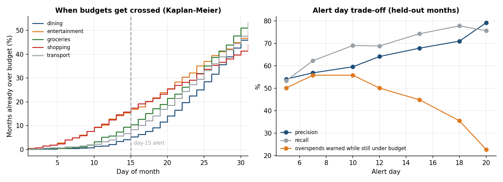
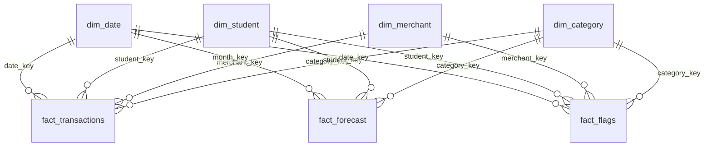
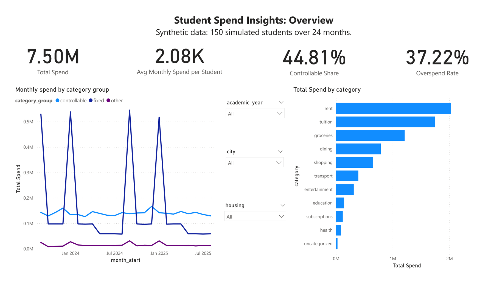
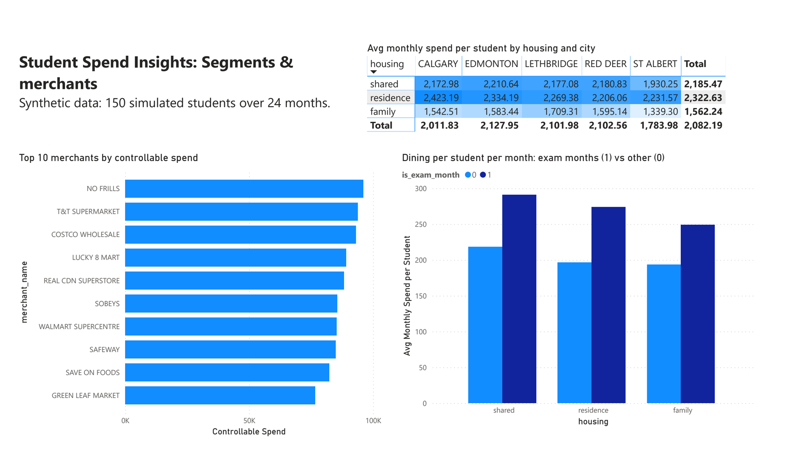
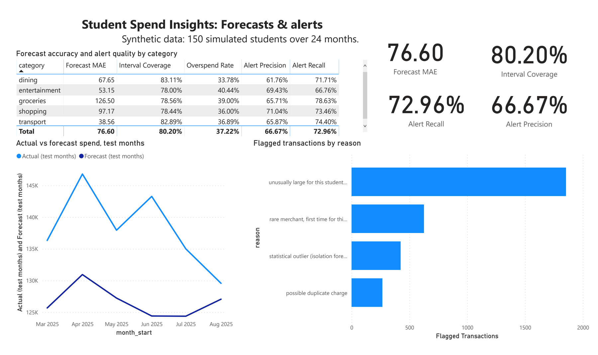

# Student Spend Insights

An end-to-end analytics pipeline that turns messy student bank transactions into answers to three questions: **where does the money go, what will next month look like, and when should a student be nudged about their budget?**

It covers SQL, data cleaning and profiling, categorisation, statistical testing, forecasting with calibrated uncertainty, anomaly detection, time-to-event (survival) analysis, and the design of an experiment to measure whether budget nudges work. It ships with a Streamlit demo, a PowerPoint findings deck, a star schema with a three-page Power BI report, and 32 tests.

> **The data is synthetic.** No public dataset of real student transactions exists, so [`generate.py`](spendinsights/generate.py) simulates 150 students over 24 months (150,577 raw rows). Every parameter is my assumption. Numbers below describe how well the *pipeline* works on data whose ground truth I control, not how real students behave. Where a result is an artifact of the simulator, I say so.

## Headline results (seed 42, `make run`)

| Stage | Result |
|---|---|
| Cleaning | 150,577 raw rows to 150,276 clean. Parsed 4 date formats and 3 amount styles, dropped 301 exact duplicates, and kept 464 rows with missing merchant text out of auto-categorisation. |
| Categorisation, unseen merchants | Rules-first hybrid labels **73% of transactions at 99.2% accuracy** and sends the rest to review. A char-n-gram classifier alone reaches only **28.5%** on merchants it has never seen. |
| Forecasting | Walk-forward MAE **$76.6 vs $89.9** for the best baseline (14.8% lower). Nominal 80% intervals covered **77.3%** raw and **80.2%** after conformal calibration. |
| Anomaly detection | Rules find **93%** of injected anomalies, but only **31%** of what they flag is real (48x the 0.66% base rate). Isolation Forest finds 49% and misses almost all duplicates. |
| Nudge trigger | Day-15 pace rule: **68% precision, 74% recall** on held-out months vs a 37% base rate. |
| Time-to-event | Only **11.7%** of budgets are crossed by day 15 (Kaplan-Meier, censored months included). A day-10 alert warns **56%** of overspenders while still under budget, against **45%** at day 15. |
| Simulated A/B test | An assumed 10% effect is **not detectable** with 1,833 cases (p = 0.33). It needs about 6,500 per arm, or about 2,800 with CUPED variance reduction. |

## What is in each stage

```
generate -> clean -> categorise -> SQLite -> EDA -> forecast -> anomalies -> nudges -> survival -> star schema -> deck / dashboard / Power BI
```

### 1. Messy input, real cleaning ([`clean.py`](spendinsights/clean.py))
The raw export mixes ISO, `MM/DD/YYYY`, `DD-Mon-YYYY` and `Mon D, YYYY` dates, and amounts like `-$1,250.00` and `(12.50)`. It also has missing merchant text, missing debit/credit flags, and duplicate rows. Every issue is counted in [`reports/data_quality_report.md`](reports/data_quality_report.md). Slash dates are parsed as `MM/DD/YYYY`, and the report flags that this is an assumption a real pipeline must confirm with the data owner.

### 2. Categorisation: the most instructive failure ([`categorize.py`](spendinsights/categorize.py))
Only about 10% of transactions carry a trusted label. A TF-IDF character n-gram classifier labels the rest, with hand-written keyword rules first and abstention when confidence is low.

- **On a random split the model scores about 100%.** That number is an artifact: the simulator has only about 130 merchants, so the model memorises them. I report it but do not lead with it.
- **On merchants held out of training** the classifier alone is right 28.5% of the time. A brand name like "MOONLIGHT NOODLE HOUSE" carries no signal unless a model has world knowledge about what it is.
- The abstention threshold is chosen on **merchant-grouped validation**, not random rows. My first version used random validation, picked a threshold that was far too permissive, and overstated performance on new merchants. Fixing that was the main methodological lesson.
- **Caveat:** I wrote the keyword rules while looking at the simulator's merchant list, so the rules' unseen-merchant coverage (68.5%) is optimistic. A real analyst would not know the unseen merchants.

### 3. SQL and exploratory analysis ([`sql/`](sql), [`eda.py`](spendinsights/eda.py))
Five queries, including window functions (`LAG` for month-over-month change, `SUM() OVER ()` for shares) and a recurring-charge detector. Findings on the synthetic data:


- Rent and tuition are 50.3% of all spend. Of the controllable part, groceries and dining are 59.5%.
- The median student spends $922/month on variable categories (p10 $691, p90 $1,183).
- **Tested hypothesis:** dining rises in exam months. Paired Wilcoxon signed-rank on per-student means gives **+$64/month (+30%), 95% bootstrap CI $55 to $74**, p < 1e-20. I built that effect into the simulator, so this demonstrates the method, not a discovery.

### 4. Forecasting with honest ranges ([`forecast.py`](spendinsights/forecast.py))
Per student and category, predict next month's spend. Gradient boosting on lag and rolling features beats three baselines in every category. Validation is walk-forward: the model for month *t* trains on months up to *t-2*, the interval is calibrated on month *t-1*, and month *t* is predicted. A test asserts that corrupting month *t*'s actuals does not change its prediction.

| Method | MAE ($) |
|---|---:|
| Last month | 107.0 |
| Seasonal naive | 106.6 |
| Rolling 3-month mean | 89.9 |
| **Gradient boosting** | **76.6** |


The raw 10%/90% quantile models undercover (77.3% vs 80% nominal). Conformalised quantile regression on the calibration month brings coverage to 80.2% at a modest width cost ($229 to $237 average width).

### 5. Anomaly detection ([`anomalies.py`](spendinsights/anomalies.py))
925 anomalies were injected (spikes, duplicate charges, unknown merchants). Detectors only see cleaned transactions and predicted categories.

| Detector | Precision | Recall |
|---|---:|---:|
| Rules (3) | 31% | 93% |
| Isolation Forest | 33% | 49% |
| Union | 27% | 94% |

The per-rule breakdown is the useful part: the duplicate-pair rule is 98.5% precise, the spike rule 29%, and the rare-merchant rule 18%. Isolation Forest catches unknown merchants (95%) but almost no duplicates (3%), because a duplicate is not a statistical outlier. A review queue built from these flags needs triage, and this is why.

### 6. Nudges and experiment design ([`nudges.py`](spendinsights/nudges.py))
Budget = forecast median. At day 15, project month-end spend from pace and nudge if it exceeds tau x budget. Tau was tuned on the first half of the test months and scored on the second half.

- **Trigger quality (real, retrospective):** precision 67.8%, recall 74.2% at tau = 1.1, against a 36.6% base rate of material overspend (actual > 115% of budget).
- **Simulated experiment (assumption-driven):** I assume a nudge cuts remaining-month spend by 10%. This is not evidence that nudges work. What it demonstrates is measurement: randomisation, a bootstrap CI, CUPED using the forecast as a pre-treatment covariate (57.6% variance reduction), and a power analysis.


With 1,833 flagged cases the difference is $9.0 (95% CI -$8.4 to $27.1, p = 0.33). The practical lesson is that month-level dollar outcomes are noisy, so a real test would need a longer horizon, a better metric, or thousands of users.

### 7. When do budgets get crossed? Time-to-event analysis ([`survival.py`](spendinsights/survival.py))
The day-15 alert raises a timing question: a warning only helps if it arrives while the student is still under budget. For each student, category and test month (4,500 in all), the event is the first day cumulative spend passes the budget. 51.7% of months never cross, so they are right-censored at month end, and Kaplan-Meier curves ([`lifelines`](https://lifelines.readthedocs.io)) count them correctly instead of averaging only the months that did cross.

- **Most crossings come late.** Only 11.7% of months are over budget by day 15, against 48.3% by month end. Among material overspends the median crossing day is 20, and 30% are already over budget by day 15.
- **Shopping and entertainment cross early but less often.** About 17% of them are over budget by day 15, against 5% for dining, yet shopping crosses least by month end (43%). Because the curves cross, a single hazard ratio per category would mislead: the proportional-hazards test rejects it for every category (p &le; 0.012), so the Cox model is stratified by category.
- **Who the student is barely matters.** Housing and budget size have hazard ratios close to 1 (shared housing 1.12, 95% CI 1.00 to 1.24), and the model ranks held-out months no better than chance (concordance 0.48). Timing comes from how fast a student spends within the month, which is what the pace-based alert measures. The simulator sets each budget from the student's own forecast, so a weak student effect is expected here.
- **The alert day is a trade-off.** Re-tuning the alert for each day on the first half of the test months and scoring it on the second half, a day-10 alert reaches 55.8% of material overspends while the student is still under budget, against 44.8% at day 15, at the cost of precision (59.5% against 67.8%). Later alerts are more accurate but arrive after the budget is gone, so a day-10 warning with a day-15 reminder is the natural next test.



### 8. Star schema for BI ([`warehouse.py`](spendinsights/warehouse.py), [`sql/bi/`](sql/bi))
The analysis tables are shaped for Python. BI tools like Power BI work best with a star schema instead: narrow fact tables for each business event, joined on integer keys to small descriptive dimensions. The pipeline builds one in the same SQLite database.



| Table | Grain | Rows (seed 42) |
|---|---|---:|
| `fact_transactions` | one cleaned transaction | 150,276 |
| `fact_forecast` | one student, category and test month, with the forecast, its 80% range, and the day-15 budget alert | 4,500 |
| `fact_flags` | one anomaly flag, with its reason | 3,167 |
| `dim_date` | one calendar day (month, academic year, exam-month flag) | 731 |
| `dim_student` / `dim_merchant` / `dim_category` | housing and city / standardised merchant name / fixed, controllable or other | 150 / 403 / 12 |

Six queries in [`sql/bi/`](sql/bi) answer questions through joins: spend by housing type and city, fixed versus controllable spend by month, a merchant leaderboard, forecast error and alert quality by category, the exam-month effect by housing, and flags by reason. Tests check that every foreign key resolves and that the star schema reproduces the pipeline's own numbers exactly: the same transaction totals, MAE ($76.6), interval coverage (80.2%), and held-out alert precision and recall (67.8%, 74.2%). `make bi` exports every table as CSV for Power BI.

### 9. Power BI report ([`powerbi/`](powerbi))
[`student_spend_insights.pbix`](powerbi/student_spend_insights.pbix) loads the seven CSVs into a model with the relationships in the diagram above, 18 DAX measures and three pages. Before building any page I checked every measure against the pipeline: total spend $7,495,878.47, MAE 76.60, interval coverage 80.2%, and alert precision and recall of 66.7% and 73.0% across all six test months (the 67.8% and 74.2% above score only the held-out second half). [`powerbi/README.md`](powerbi/README.md) lists every relationship and measure, and the [PDF export](powerbi/student_spend_insights.pdf) shows the report without Power BI.

**Overview.** Spend by month and category, with slicers for academic year, city and housing. The four spikes in fixed spend are tuition, due each September and January.



**Segments and merchants.** Students who live with family spend about $1,560 a month, against $2,320 in residence and $2,190 in shared housing. Dining per student rises 28% to 39% in exam months (December and April) for every housing type. Small cells are noisy: St Albert has only 8 students.



**Forecasts and alerts.** Groceries is the hardest category to forecast (MAE $126.50) and transport the easiest ($38.56). Summed over all students, the forecast sits below actual spend in every test month, by 2% to 13%. That is expected from a median forecast on right-skewed spending rather than a bias in each forecast: actual spend lands above the forecast in 48% of rows. A budget total built from these forecasts would need a mean forecast instead.



## Run it

```bash
python3 -m venv .venv && source .venv/bin/activate
make install       # or: pip install -r requirements-lock.txt for exact reproduction
make run          # full pipeline, about 20-60 seconds; writes data/, reports/
make test         # 32 tests
make bi           # rebuild the star schema and export data/powerbi/*.csv for Power BI
make dashboard    # Streamlit demo (run `make run` first)
```

`make quick` runs a small version (40 students, 16 months).

**Reproducibility.** Runs are deterministic for a given set of library versions. `pip install -r requirements-lock.txt` installs the exact versions behind every number in this README, and a fresh run then reproduces `reports/metrics.json` byte for byte. `requirements.txt` installs the newest releases instead: all tests pass there too, but library changes shift a couple of figures in the last digit (for example conformal coverage 80.3% instead of 80.2%).

Outputs: [`reports/metrics.json`](reports/metrics.json) (every number above), [`reports/findings_deck.pptx`](reports/findings_deck.pptx) (six slides), [`reports/figures/`](reports/figures), and `data/spend.db` (SQLite, not committed).

## Repository layout

```
spendinsights/   generate, clean, categorize, db, eda, forecast, anomalies, nudges, survival, warehouse, deck, pipeline
sql/             analysis queries (window functions, recurring-charge detection)
sql/bi/          star-schema queries with joins, for BI questions
dashboard/       Streamlit app: set budgets, see mid-month projection, flags, subscriptions
powerbi/         Power BI report (.pbix and PDF export) and its build guide: model, DAX measures, pages
tests/           cleaning, generator, categoriser, leakage tests for forecasting, budget-crossing and censoring, star-schema integrity, end-to-end smoke test
reports/         metrics.json, data quality report, figures, findings deck
```

## Limitations

- **Synthetic data.** Effect sizes (exam-month dining lift, seasonality, spending levels) come from my simulator. Real data will be messier and less separable.
- **Categorisation of unseen merchants is unsolved here.** The obvious next step is pretrained text embeddings or an LLM classifier, evaluated the same way (merchant-grouped, with abstention).
- **Anomaly thresholds are tuned to the simulator** (for example, the rare-merchant cutoff), and precision is low by design of the rules. Real deployment needs a feedback loop from reviewers.
- **Forecast horizon and data are limited:** 24 months, six test months, one-step-ahead only.
- **The A/B result is a demonstration of method**, not a finding about nudges.
- **The time-to-event analysis covers six test months** and uses forecast medians as budgets. Its category timing comes from the simulator's purchase patterns.

## Tested with

- **Locked** (`requirements-lock.txt`): Python 3.9 and 3.11 with pandas 2.3.3, numpy 2.0.2, scikit-learn 1.6.1, scipy 1.13.1, matplotlib 3.9.4, streamlit 1.50.0, python-pptx 1.0.2.
- **Latest** (`requirements.txt`, checked on Python 3.11): pandas 3.0, numpy 2.4, scikit-learn 1.9, scipy 1.17, matplotlib 3.11.

Continuous integration runs the test suite against both sets.

## How I built this

I used Claude Code as an AI pair programmer, mainly to write implementation code. I chose what to build and which questions to ask, approved each design before it was written, built the Power BI report myself in Power BI Desktop, and checked the reported numbers against the pipeline's output.

## License

MIT
