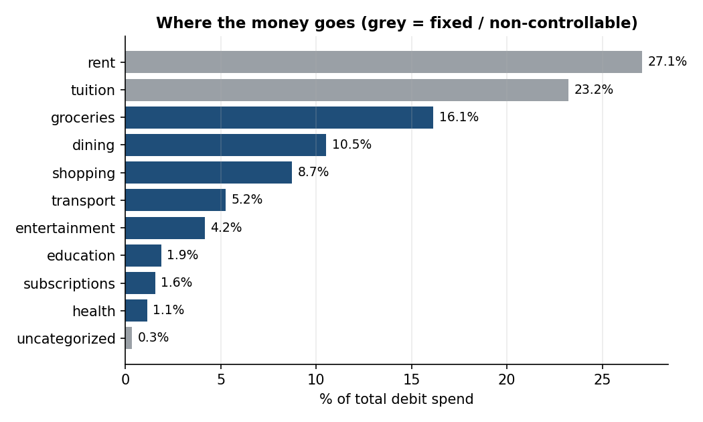
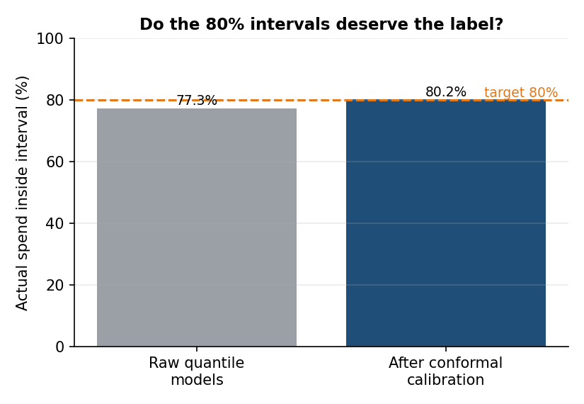
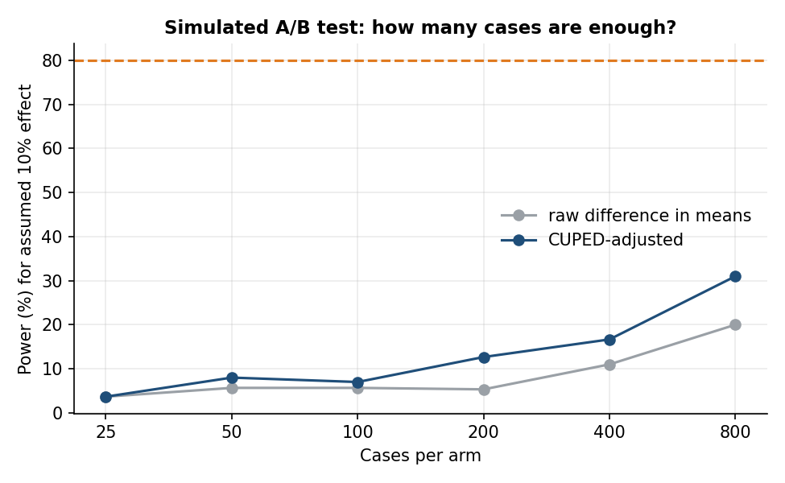

# Student Spend Insights

An end-to-end analytics pipeline that turns messy student bank transactions into answers to three questions: **where does the money go, what will next month look like, and when should a student be nudged about their budget?**

It covers SQL, data cleaning and profiling, categorisation, statistical testing, forecasting with calibrated uncertainty, anomaly detection, and the design of an experiment to measure whether budget nudges work. It ships with a Streamlit demo, a PowerPoint findings deck, and 20 tests.

> **The data is synthetic.** No public dataset of real student transactions exists, so [`generate.py`](spendinsights/generate.py) simulates 150 students over 24 months (150,577 raw rows). Every parameter is my assumption. Numbers below describe how well the *pipeline* works on data whose ground truth I control, not how real students behave. Where a result is an artifact of the simulator, I say so.

## Headline results (seed 42, `make run`)

| Stage | Result |
|---|---|
| Cleaning | 150,577 raw rows to 150,276 clean. Parsed 4 date formats and 3 amount styles, dropped 301 exact duplicates, and kept 464 rows with missing merchant text out of auto-categorisation. |
| Categorisation, unseen merchants | Rules-first hybrid labels **73% of transactions at 99.2% accuracy** and sends the rest to review. A char-n-gram classifier alone reaches only **28.5%** on merchants it has never seen. |
| Forecasting | Walk-forward MAE **$76.6 vs $89.9** for the best baseline (14.8% lower). Nominal 80% intervals covered **77.3%** raw and **80.2%** after conformal calibration. |
| Anomaly detection | Rules find **93%** of injected anomalies, but only **31%** of what they flag is real (48x the 0.66% base rate). Isolation Forest finds 49% and misses almost all duplicates. |
| Nudge trigger | Day-15 pace rule: **68% precision, 74% recall** on held-out months vs a 37% base rate. |
| Simulated A/B test | An assumed 10% effect is **not detectable** with 1,833 cases (p = 0.33). It needs about 6,500 per arm, or about 2,800 with CUPED variance reduction. |

## What is in each stage

```
generate -> clean -> categorise -> SQLite -> EDA -> forecast -> anomalies -> nudges -> deck / dashboard
```

### 1. Messy input, real cleaning ([`clean.py`](spendinsights/clean.py))
The raw export mixes ISO, `MM/DD/YYYY`, `DD-Mon-YYYY` and `Mon D, YYYY` dates, and amounts like `-$1,250.00` and `(12.50)`. It also has missing merchant text, missing debit/credit flags, and duplicate rows. Every issue is counted in [`reports/data_quality_report.md`](reports/data_quality_report.md). Slash dates are parsed as `MM/DD/YYYY`, and the report flags that this is an assumption a real pipeline must confirm with the data owner.

### 2. Categorisation: the most instructive failure ([`categorize.py`](spendinsights/categorize.py))
Only about 10% of transactions carry a trusted label. A TF-IDF character n-gram classifier labels the rest, with hand-written keyword rules first and abstention when confidence is low.

- **On a random split the model scores about 100%.** That number is an artifact: the simulator has only about 130 merchants, so the model memorises them. I report it but do not lead with it.
- **On merchants held out of training** the classifier alone is right 28.5% of the time. A brand name like "MOONLIGHT NOODLE HOUSE" carries no signal unless a model has world knowledge about what it is.
- The abstention threshold is chosen on **merchant-grouped validation**, not random rows. My first version used random validation, picked a threshold that was far too permissive, and overstated performance on new merchants. Fixing that was the main methodological lesson.
- **Caveat:** I wrote the keyword rules while looking at the simulator's merchant list, so the rules' unseen-merchant coverage (68.5%) is optimistic. A real analyst would not know the unseen merchants.

### 3. SQL and exploratory analysis ([`sql/`](sql), [`eda.py`](spendinsights/eda.py))
Five queries, including window functions (`LAG` for month-over-month change, `SUM() OVER ()` for shares) and a recurring-charge detector. Findings on the synthetic data:



- Rent and tuition are 50.3% of all spend. Of the controllable part, groceries and dining are 59.5%.
- The median student spends $922/month on variable categories (p10 $691, p90 $1,183).
- **Tested hypothesis:** dining rises in exam months. Paired Wilcoxon signed-rank on per-student means gives **+$64/month (+30%), 95% bootstrap CI $55 to $74**, p < 1e-20. I built that effect into the simulator, so this demonstrates the method, not a discovery.

### 4. Forecasting with honest ranges ([`forecast.py`](spendinsights/forecast.py))
Per student and category, predict next month's spend. Gradient boosting on lag and rolling features beats three baselines in every category. Validation is walk-forward: the model for month *t* trains on months up to *t-2*, the interval is calibrated on month *t-1*, and month *t* is predicted. A test asserts that corrupting month *t*'s actuals does not change its prediction.

| Method | MAE ($) |
|---|---:|
| Last month | 107.0 |
| Seasonal naive | 106.6 |
| Rolling 3-month mean | 89.9 |
| **Gradient boosting** | **76.6** |



The raw 10%/90% quantile models undercover (77.3% vs 80% nominal). Conformalised quantile regression on the calibration month brings coverage to 80.2% at a modest width cost ($229 to $237 average width).

### 5. Anomaly detection ([`anomalies.py`](spendinsights/anomalies.py))
925 anomalies were injected (spikes, duplicate charges, unknown merchants). Detectors only see cleaned transactions and predicted categories.

| Detector | Precision | Recall |
|---|---:|---:|
| Rules (3) | 31% | 93% |
| Isolation Forest | 33% | 49% |
| Union | 27% | 94% |

The per-rule breakdown is the useful part: the duplicate-pair rule is 98.5% precise, the spike rule 29%, and the rare-merchant rule 18%. Isolation Forest catches unknown merchants (95%) but almost no duplicates (3%), because a duplicate is not a statistical outlier. A review queue built from these flags needs triage, and this is why.

### 6. Nudges and experiment design ([`nudges.py`](spendinsights/nudges.py))
Budget = forecast median. At day 15, project month-end spend from pace and nudge if it exceeds tau x budget. Tau was tuned on the first half of the test months and scored on the second half.

- **Trigger quality (real, retrospective):** precision 67.8%, recall 74.2% at tau = 1.1, against a 36.6% base rate of material overspend (actual > 115% of budget).
- **Simulated experiment (assumption-driven):** I assume a nudge cuts remaining-month spend by 10%. This is not evidence that nudges work. What it demonstrates is measurement: randomisation, a bootstrap CI, CUPED using the forecast as a pre-treatment covariate (57.6% variance reduction), and a power analysis.



With 1,833 flagged cases the difference is $9.0 (95% CI -$8.4 to $27.1, p = 0.33). The practical lesson is that month-level dollar outcomes are noisy, so a real test would need a longer horizon, a better metric, or thousands of users.

## Run it

```bash
python3 -m venv .venv && source .venv/bin/activate
make install
make run          # full pipeline, about 20-60 seconds; writes data/, reports/
make test         # 20 tests
make dashboard    # Streamlit demo (run `make run` first)
```

`make quick` runs a small version (40 students, 16 months). Results are deterministic: two full runs produce byte-identical `reports/metrics.json`.

Outputs: [`reports/metrics.json`](reports/metrics.json) (every number above), [`reports/findings_deck.pptx`](reports/findings_deck.pptx) (six slides), [`reports/figures/`](reports/figures), and `data/spend.db` (SQLite, not committed).

## Repository layout

```
spendinsights/   generate, clean, categorize, db, eda, forecast, anomalies, nudges, deck, pipeline
sql/             analysis queries (window functions, recurring-charge detection)
dashboard/       Streamlit app: set budgets, see mid-month projection, flags, subscriptions
tests/           cleaning, generator, categoriser, leakage tests for forecasting, end-to-end smoke test
reports/         metrics.json, data quality report, figures, findings deck
```

## Limitations

- **Synthetic data.** Effect sizes (exam-month dining lift, seasonality, spending levels) come from my simulator. Real data will be messier and less separable.
- **Categorisation of unseen merchants is unsolved here.** The obvious next step is pretrained text embeddings or an LLM classifier, evaluated the same way (merchant-grouped, with abstention).
- **Anomaly thresholds are tuned to the simulator** (for example, the rare-merchant cutoff), and precision is low by design of the rules. Real deployment needs a feedback loop from reviewers.
- **Forecast horizon and data are limited:** 24 months, six test months, one-step-ahead only.
- **The A/B result is a demonstration of method**, not a finding about nudges.

## Tested with

Python 3.9, pandas 2.3, numpy 2.0, scikit-learn 1.6, scipy 1.13, matplotlib 3.9, streamlit 1.50, python-pptx 1.0.

## License

MIT
